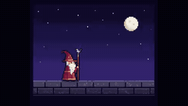
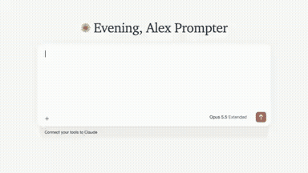
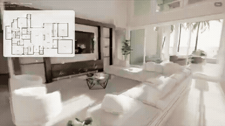
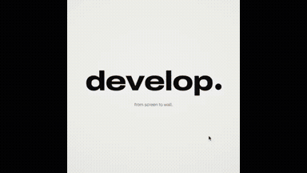
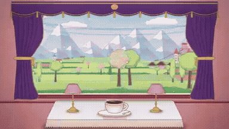
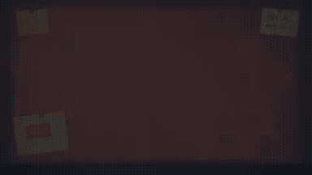
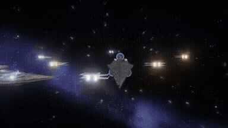
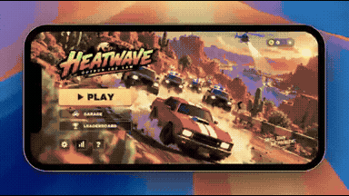
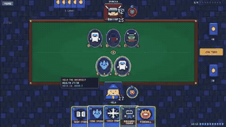
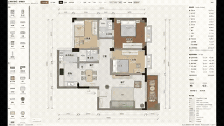

# Awesome Gemini 4 Video Prompts

**Creator-shared prompts, visual previews, and practical setup notes — curated by Leadde Open Lab.** Find the original prompt and source, watch selected results, and check the tools and inputs before you try them. Return for fresh picks for your next video, animation or 3D project.

**☆ Star this repo to keep the prompts handy for your next project.**

**[Open the web collection →](https://leaddeopenlab.github.io/awesome-gemini4-video-prompts/)** · Video previews, prompts & setup · English / 简体中文

[Motion graphics](https://leaddeopenlab.github.io/awesome-gemini4-video-prompts/collections/motion-graphics/) · [Explainers](https://leaddeopenlab.github.io/awesome-gemini4-video-prompts/collections/explainers/) · [3D worlds](https://leaddeopenlab.github.io/awesome-gemini4-video-prompts/collections/3d-worlds/)

[Browse the full repository](#browse-the-full-library) · [Start with a prompt](#start-here) · [Latest additions](#recently-added)

## Featured creations

Read the prompt here on GitHub, or watch the preview and check setup notes on the website.

<table>
<tr>
<td width="50%" valign="top">
 
<strong>Motion Designer Résumé Showreel and Remotion</strong> 

<a href="prompts/2103449416325890146.md">View prompt · GitHub</a> · <a href="https://leaddeopenlab.github.io/awesome-gemini4-video-prompts/prompts/remotion-motion-design-showreel/">Watch preview · Website ↗</a> · <a href="https://x.com/ajith_io/status/2103449416325890146">Original post ↗</a>
</td>
<td width="50%" valign="top">
 
<strong>Vincent's Cats: 3D Starry Night Game</strong> 

<a href="prompts/2103802923465768972.md">View prompt · GitHub</a> · <a href="https://leaddeopenlab.github.io/awesome-gemini4-video-prompts/prompts/starry-night-3d-cats-prompt/">Watch preview · Website ↗</a> · <a href="https://x.com/MandelDuck/status/2103802923465768972">Original post ↗</a>
</td>
</tr>
<tr>
<td width="50%" valign="top">
 
<strong>Code-Driven Looping UI Motion Graphics</strong> 

<a href="prompts/2103273003555402193.md">View prompt · GitHub</a> · <a href="https://leaddeopenlab.github.io/awesome-gemini4-video-prompts/prompts/looping-ui-motion-prompt/">Watch preview · Website ↗</a> · <a href="https://x.com/twoclipping/status/2103273003555402193">Original post ↗</a>
</td>
<td width="50%" valign="top">
 
<strong>Opus 5.5 and Manim Educational Video Explaining Derivatives</strong> 

<a href="prompts/2103128559174971663.md">View prompt · GitHub</a> · <a href="https://leaddeopenlab.github.io/awesome-gemini4-video-prompts/prompts/manim-derivatives-explainer/">Watch preview · Website ↗</a> · <a href="https://x.com/LinearUncle/status/2103128559174971663">Original post ↗</a>
</td>
</tr>
<tr>
<td width="50%" valign="top">
 
<strong>1906 San Francisco Market Street Blender Reconstruction</strong> 

<a href="prompts/2102466523164274839.md">View prompt · GitHub</a> · <a href="https://leaddeopenlab.github.io/awesome-gemini4-video-prompts/prompts/blender-1906-san-francisco/">Watch preview · Website ↗</a> · <a href="https://x.com/alexalbert__/status/2102466523164274839">Original post ↗</a>
</td>
<td width="50%" valign="top">
 
<strong>Animated Pixel Art Wizard in Canvas 2D</strong> 

<a href="prompts/2102476258948927543.md">View prompt · GitHub</a> · <a href="https://leaddeopenlab.github.io/awesome-gemini4-video-prompts/prompts/pixel-art-wizard-html-prompt/">Watch preview · Website ↗</a> · <a href="https://x.com/majidmanzarpour/status/2102476258948927543">Original post ↗</a>
</td>
</tr>
</table>

## Start here

Pick a result to try. Setup instructions are on each prompt page; these examples have not been reproduced by this repository.

<table>
<tr>
<td width="33%" valign="top">
 
<strong>Easiest start: pixel-art wizard</strong> 
Copy the prompt, save one HTML file, and open it in your browser. No external assets. 
<a href="https://leaddeopenlab.github.io/awesome-gemini4-video-prompts/prompts/pixel-art-wizard-html-prompt/">Copy prompt &amp; setup →</a>
</td>
<td width="33%" valign="top">
 
<strong>Your product: a 30-second business explainer</strong> 
Replace the business description and brand colors, then preview the HTML animation. 
<a href="https://leaddeopenlab.github.io/awesome-gemini4-video-prompts/prompts/business-explainer-html-prompt/">Copy prompt &amp; setup →</a>
</td>
<td width="33%" valign="top">
 
<strong>Teach a concept: derivatives with Manim</strong> 
Generate a narrated lesson with Manim and edge-tts. Python setup required. 
<a href="https://leaddeopenlab.github.io/awesome-gemini4-video-prompts/prompts/manim-derivatives-explainer/">Copy prompt &amp; setup →</a>
</td>
</tr>
</table>

## Recently added

<table>
<tr>
<td width="33%" valign="top">
 
<strong>Interactive 3D Snow Globe Comparison</strong> 

<a href="https://x.com/shmopixbzn/status/2110057151171338656">Original post ↗</a> · <a href="prompts/2110057151171338656.md">Prompt ↗</a>
</td>
<td width="33%" valign="top">
 
<strong>Paper Rapids: Sunlit Creek Run and Canvas Promo Trailer</strong> 

<a href="https://x.com/jeffbruchado/status/2110038361062723704">Original post ↗</a> · <a href="prompts/2110038361062723704.md">Prompt ↗</a>
</td>
<td width="33%" valign="top">
 
<strong>Floor Plan to Interactive 3D Walkthrough via Three.js</strong> 

<a href="https://x.com/everestchris6/status/2110036224320884998">Original post ↗</a> · <a href="prompts/2110036224320884998.md">Prompt ↗</a>
</td>
</tr>
</table>

## Browse the full library

- [Product & Brand Videos](data/categories/product-brand.md) (84)
- [Motion Graphics & Typography](data/categories/motion-graphics.md) (226)
- [UI & Web Animation](data/categories/ui-web.md) (17)
- [Explainers & Education](data/categories/explainers.md) (83)
- [Music & Storytelling](data/categories/music-storytelling.md) (31)
- [3D Worlds & Simulations](data/categories/3d-scenes.md) (93)
- [Games & Interactive Experiences](data/categories/games-interactive.md) (84)

30 homepage picks · Original creator links on every card.

## Product & Brand Videos — homepage picks

<table>
<tr>
<td width="33%" valign="top">
 
<strong>Product Promo Video Generation</strong> 

<a href="https://x.com/felipemoller/status/2103846311149936736">Original post ↗</a> · <a href="prompts/2103846311149936736.md">Prompt ↗</a>
</td>
<td width="33%" valign="top">
 
<strong>Code-Driven Motion Design Video</strong> 

<a href="https://x.com/twoclipping/status/2102554209166000267">Original post ↗</a> · <a href="prompts/2102554209166000267.md">Prompt ↗</a>
</td>
<td width="33%" valign="top">
 
<strong>Code-Based Apple-Style Keynote Motion Design</strong> 

<a href="https://x.com/twoclipping/status/2103835273813496100">Original post ↗</a> · <a href="prompts/2103835273813496100.md">Prompt ↗</a>
</td>
</tr>
<tr>
<td width="33%" valign="top">
 
<strong>Opus 5.5 Ad Inspired by Apple 1984</strong> 

<a href="https://x.com/1littlecoder/status/2103746736980378066">Original post ↗</a> · <a href="prompts/2103746736980378066.md">Prompt ↗</a>
</td>
<td width="33%" valign="top">
 
<strong>Remotion Product Intro</strong> 

<a href="https://x.com/HO_BA/status/2103845264649761062">Original post ↗</a> · <a href="prompts/2103845264649761062.md">Prompt ↗</a>
</td><td></td>
</tr>
</table>

[Browse all 84 product & brand videos →](data/categories/product-brand.md)

## Motion Graphics & Typography — homepage picks

<table>
<tr>
<td width="33%" valign="top">
 
<strong>Infinite Zoom Vintage Collage Animation</strong> 

<a href="https://x.com/koldo2k/status/2103129343253778767">Original post ↗</a> · <a href="prompts/2103129343253778767.md">Prompt ↗</a>
</td>
<td width="33%" valign="top">
 
<strong>Spotify-Themed Motion Design</strong> 

<a href="https://x.com/brainextends/status/2103801834930606193">Original post ↗</a> · <a href="prompts/2103801834930606193.md">Prompt ↗</a>
</td>
<td width="33%" valign="top">
 
<strong>Four Seasons Train Window Animation</strong> 

<a href="https://x.com/itsolelehmann/status/2103124033365762215">Original post ↗</a> · <a href="prompts/2103124033365762215.md">Prompt ↗</a>
</td>
</tr>
</table>

[Browse all 226 motion graphics & typography →](data/categories/motion-graphics.md)

## UI & Web Animation — homepage picks

<table>
<tr>
<td width="33%" valign="top">
 
<strong>Three.js 15s 3D Motion Graphics</strong> 

<a href="https://x.com/hiro19_k/status/2104471436039803295">Original post ↗</a> · <a href="prompts/2104471436039803295.md">Prompt ↗</a>
</td>
<td width="33%" valign="top">
 
<strong>Auren Header Scroll-Scrubbed Hero Section</strong> 

<a href="https://x.com/iamtanzil_/status/2103820321673675031">Original post ↗</a> · <a href="prompts/2103820321673675031.md">Prompt ↗</a>
</td><td></td>
</tr>
</table>

[Browse all 17 ui & web animation →](data/categories/ui-web.md)

## Explainers & Education — homepage picks

<table>
<tr>
<td width="33%" valign="top">
 
<strong>Recursion Explanation Video</strong> 

<a href="https://x.com/emollick/status/2103688362960019567">Original post ↗</a> · <a href="prompts/2103688362960019567.md">Prompt ↗</a>
</td>
<td width="33%" valign="top">
 
<strong>Japan Summer Weather Visualization</strong> 

<a href="https://x.com/GroundControl/status/2103678647777230877">Original post ↗</a> · <a href="prompts/2103678647777230877.md">Prompt ↗</a>
</td>
<td width="33%" valign="top">
 
<strong>Photon Journey Explainer Animation</strong> 

<a href="https://x.com/AstroTheWizard/status/2103629247751618782">Original post ↗</a> · <a href="prompts/2103629247751618782.md">Prompt ↗</a>
</td>
</tr>
<tr>
<td width="33%" valign="top">
 
<strong>Negroni Cocktail Explainer Motion Graphic in HTML</strong> 

<a href="https://x.com/Ror_Fly/status/2102853258582880547">Original post ↗</a> · <a href="prompts/2102853258582880547.md">Prompt ↗</a>
</td>
<td width="33%" valign="top">
 
<strong>Educational Motion-Graphics on Recursive AI Agent Limitations</strong> 

<a href="https://x.com/M_Adrian2/status/2104542961081983435">Original post ↗</a> · <a href="prompts/2104542961081983435.md">Prompt ↗</a>
</td><td></td>
</tr>
</table>

[Browse all 83 explainers & education →](data/categories/explainers.md)

## Music & Storytelling — homepage picks

<table>
<tr>
<td width="33%" valign="top">
 
<strong>Animated Music Video Prompt for Claude Opus</strong> 

<a href="https://x.com/doubleunplussed/status/2103697580421181894">Original post ↗</a> · <a href="prompts/2103697580421181894.md">Prompt ↗</a>
</td><td></td><td></td>
</tr>
</table>

[Browse all 31 music & storytelling →](data/categories/music-storytelling.md)

## 3D Worlds & Simulations — homepage picks

<table>
<tr>
<td width="33%" valign="top">
 
<strong>Cinematic Browser-Based 3D World</strong> 

<a href="https://x.com/LexnLin/status/2103194052850241739">Original post ↗</a> · <a href="prompts/2103194052850241739.md">Prompt ↗</a>
</td>
<td width="33%" valign="top">
 
<strong>Pelican Riding a Bicycle Animation</strong> 

<a href="https://x.com/AxtonLiu/status/2103119648271290566">Original post ↗</a> · <a href="prompts/2103119648271290566.md">Prompt ↗</a>
</td>
<td width="33%" valign="top">
 
<strong>Interactive WebGPU Strawberry Cake Soft-Body Physics</strong> 

<a href="https://x.com/ImaStudio_ai/status/2104514806443303238">Original post ↗</a> · <a href="prompts/2104514806443303238.md">Prompt ↗</a>
</td>
</tr>
</table>

[Browse all 93 3d worlds & simulations →](data/categories/3d-scenes.md)

## Games & Interactive Experiences — homepage picks

<table>
<tr>
<td width="33%" valign="top">
 
<strong>3D Star Wars Multiplayer Game</strong> 

<a href="https://x.com/0xChuckstock/status/2103804606794879327">Original post ↗</a> · <a href="prompts/2103804606794879327.md">Prompt ↗</a>
</td>
<td width="33%" valign="top">
 
<strong>Police Chase Arcade Game PRD</strong> 

<a href="https://x.com/froessell/status/2103789415323562325">Original post ↗</a> · <a href="prompts/2103789415323562325.md">Prompt ↗</a>
</td>
<td width="33%" valign="top">
 
<strong>Pixel Art Hearthstone-Style Card Game</strong> 

<a href="https://x.com/aisongman/status/2103763192971461057">Original post ↗</a> · <a href="prompts/2103763192971461057.md">Prompt ↗</a>
</td>
</tr>
<tr>
<td width="33%" valign="top">
 
<strong>Interactive 2D/3D Floor Plan and Interior Design Web Tool</strong> 

<a href="https://x.com/akokoi1/status/2104520072014508316">Original post ↗</a> · <a href="prompts/2104520072014508316.md">Prompt ↗</a>
</td>
<td width="33%" valign="top">
 
<strong>Interactive Rain Window Calming App</strong> 

<a href="https://x.com/d_llm_kr/status/2104189915693269112">Original post ↗</a> · <a href="prompts/2104189915693269112.md">Prompt ↗</a>
</td><td></td>
</tr>
</table>

[Browse all 84 games & interactive experiences →](data/categories/games-interactive.md)

Browse by tool

- [canvas-interactive](data/categories/canvas-interactive.md) — 84
- [manim](data/categories/manim.md) — 2
- [remotion](data/categories/remotion.md) — 14
- [blender](data/categories/blender.md) — 8
- [external-video-model](data/categories/external-video-model.md) — 11
- [other-animation](data/categories/other-animation.md) — 501

## How to use

1. Pick a result and copy its public prompt from the card or detail page.
2. Supply any inputs listed by the creator, then use the prompt with your Opus agent.
3. Follow the creator’s renderer/tool setup. A shared fragment may need additional instructions.

About this collection &amp; source checks

Opus directs or writes the code for these videos, animations and interactive recordings. The detail page distinguishes prompt-required tools, author-confirmed tools and unconfirmed inferences. Author claims and media consistency checks do not establish repository reproduction. Reference cases may have unverified model version or production details; they are not counted as fully verified cases. We do not reconstruct missing author prompts.

[Review queue](data/docs/REVIEW-QUEUE.md) · [Contribute](data/docs/CONTRIBUTING.md) · [Attribution & corrections](data/docs/RIGHTS.md)

## Credits

Maintained by [LeaddeOpenLab](https://github.com/LeaddeOpenLab) · [Leadde.ai](https://Leadde.ai). All works and prompts belong to their linked creators. Independent collection.
