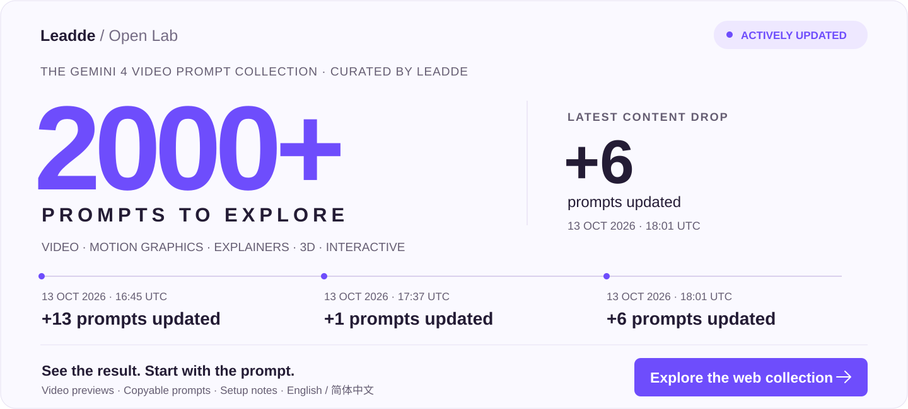

# Awesome Gemini 4 (Argon / Veo / Omni) Video Prompts & Animation Workflows

**More from Leadde Open Lab: [Awesome Opus 5.5 Video Prompts →](https://github.com/LeaddeOpenLab/awesome-opus-5-5-video-prompts)**

[English](README.md) · 简体中文

**由 Leadde Open Lab 整理的 Gemini 4 Argon 创作、视频预览与公开提示词。**

**[打开在线作品集 →](https://leaddeopenlab.github.io/awesome-gemini4-video-prompts/)** · English / 简体中文

**☆ Star 本仓库，为下一个项目收藏灵感。**

294 条视频案例 · 47 条公开提示词或模板 · 5 个分类。

其余作品明确标注未公开提示词，保留作者原帖供参考。

[精选作品](#featured-creations) · [从这里开始](#start-here) · [完整分类](#browse-the-full-library)

## 精选作品

从 47 条公开提示词或模板中，结合点赞、评论、转发和可复用性选取。互动数据采集于 2026-10-14，随时间变化。

<table>
<tr>
<td width="50%" valign="top"> <strong>果冻海岛：Argon 与 Opus 对比</strong> <a href="prompts/2110047989280670072.md">查看提示词 · GitHub</a> · <a href="https://leaddeopenlab.github.io/awesome-gemini4-video-prompts/prompts/2110047989280670072/">观看视频</a> · <a href="https://x.com/Adidotdev/status/2110047989280670072">@Adidotdev ↗</a> ♥ 339 · 31 评论 · 19 转发 47 条公开提示词中互动最高；场景、交互、物理和单文件要求完整，可替换为其他微缩景观。<blockquote><strong>💡 Pro Tip</strong> Prompt technique Specifies one index.html and Three.js r165, then separates water, materials, character and physics into explicit requirements; adapt one subsystem at a time.</blockquote></td>
<td width="50%" valign="top"> <strong>体素 F1 赛车</strong> <a href="prompts/2110048102321365205.md">查看提示词 · GitHub</a> · <a href="https://leaddeopenlab.github.io/awesome-gemini4-video-prompts/prompts/2110048102321365205/">观看视频</a> · <a href="https://x.com/HarshithLucky3/status/2110048102321365205">@HarshithLucky3 ↗</a> ♥ 207 · 18 评论 · 8 转发 互动总量第二；主题和视觉风格明确，替换车型即可复用。<blockquote><strong>💡 Pro Tip</strong> Prompt technique Pairs a named vehicle with voxel art; replace the vehicle while keeping the visual style fixed.</blockquote></td>
</tr>
<tr>
<td width="50%" valign="top"> <strong>傅里叶圆周动画：蒙娜丽莎</strong> <a href="prompts/2110045963951956250.md">查看提示词 · GitHub</a> · <a href="https://leaddeopenlab.github.io/awesome-gemini4-video-prompts/prompts/2110045963951956250/">观看视频</a> · <a href="https://x.com/fofrAI/status/2110045963951956250">@fofrAI ↗</a> ♥ 174 · 9 评论 · 10 转发 互动总量第三、86 次收藏；带有明确的主题占位符，适合反复使用。<blockquote><strong>💡 Pro Tip</strong> Prompt technique Uses [thing] as a replaceable subject while retaining the slow Fourier reveal, reference-image style and synchronized Lyria 3.5 soundtrack.</blockquote></td>
<td width="50%" valign="top"> <strong>飞越神庙的体素巨龙</strong> <a href="prompts/2110045402544341180.md">查看提示词 · GitHub</a> · <a href="https://leaddeopenlab.github.io/awesome-gemini4-video-prompts/prompts/2110045402544341180/">观看视频</a> · <a href="https://x.com/HarshithLucky3/status/2110045402544341180">@HarshithLucky3 ↗</a> ♥ 163 · 21 评论 · 3 转发 互动总量第四；生物、动作、环境的结构清晰，便于替换。<blockquote><strong>💡 Pro Tip</strong> Prompt technique Combines style, subject, action and setting in one line: voxel art + dragon + flying + temple.</blockquote></td>
</tr>
<tr>
<td width="50%" valign="top"> <strong>Blender 神社</strong> <a href="prompts/2110115515331129364.md">查看提示词 · GitHub</a> · <a href="https://leaddeopenlab.github.io/awesome-gemini4-video-prompts/prompts/2110115515331129364/">观看视频</a> · <a href="https://x.com/npaka123/status/2110115515331129364">@npaka123 ↗</a> ♥ 96 · 0 评论 · 15 转发 96 赞、15 转发、38 收藏；明确标准 API、程序化建模和 GLB 输出，可复用到建筑场景。<blockquote><strong>💡 Pro Tip</strong> Prompt technique Specifies Blender 5.x, standard APIs, procedural object creation and GLB export, making the delivery requirements concrete.</blockquote></td>
<td width="50%" valign="top"> <strong>单文件 3D 射击游戏</strong> <a href="prompts/2110119580207337739.md">查看提示词 · GitHub</a> · <a href="https://leaddeopenlab.github.io/awesome-gemini4-video-prompts/prompts/2110119580207337739/">观看视频</a> · <a href="https://x.com/npaka123/status/2110119580207337739">@npaka123 ↗</a> ♥ 56 · 0 评论 · 10 转发 56 赞、10 转发；交付格式、运行环境和一分钟流程清晰，适合作为游戏模板。<blockquote><strong>💡 Pro Tip</strong> Prompt technique Defines a single HTML file and a roughly one-minute progression from warp intro to enemies and final boss.</blockquote></td>
</tr>
</table>

## 从这里开始

<table>
<tr>
<td width="33%" valign="top"> <strong>体素 F1 赛车</strong> <a href="prompts/2110048102321365205.md">查看提示词 · GitHub</a> · <a href="https://leaddeopenlab.github.io/awesome-gemini4-video-prompts/prompts/2110048102321365205/">观看视频</a> · <a href="https://x.com/HarshithLucky3/status/2110048102321365205">@HarshithLucky3 ↗</a><blockquote><strong>💡 Pro Tip</strong> Prompt technique Pairs a named vehicle with voxel art; replace the vehicle while keeping the visual style fixed.</blockquote></td>
<td width="33%" valign="top"> <strong>傅里叶圆周动画：蒙娜丽莎</strong> <a href="prompts/2110045963951956250.md">查看提示词 · GitHub</a> · <a href="https://leaddeopenlab.github.io/awesome-gemini4-video-prompts/prompts/2110045963951956250/">观看视频</a> · <a href="https://x.com/fofrAI/status/2110045963951956250">@fofrAI ↗</a><blockquote><strong>💡 Pro Tip</strong> Prompt technique Uses [thing] as a replaceable subject while retaining the slow Fourier reveal, reference-image style and synchronized Lyria 3.5 soundtrack.</blockquote></td>
<td width="33%" valign="top"> <strong>单文件 3D 射击游戏</strong> <a href="prompts/2110119580207337739.md">查看提示词 · GitHub</a> · <a href="https://leaddeopenlab.github.io/awesome-gemini4-video-prompts/prompts/2110119580207337739/">观看视频</a> · <a href="https://x.com/npaka123/status/2110119580207337739">@npaka123 ↗</a><blockquote><strong>💡 Pro Tip</strong> Prompt technique Defines a single HTML file and a roughly one-minute progression from warp intro to enemies and final boss.</blockquote></td>
</tr>
</table>

## 最近发布

<table>
<tr>
<td width="33%" valign="top"> <strong>Fushimi Inari Shrine in Blender</strong> <a href="prompts/2110178222524731701.md">查看提示词 · GitHub</a> · <a href="https://leaddeopenlab.github.io/awesome-gemini4-video-prompts/prompts/2110178222524731701/">观看视频</a> · <a href="https://x.com/ai_prompt1/status/2110178222524731701">@ai_prompt1 ↗</a><blockquote><strong>💡 Pro Tip</strong> Prompt technique Names a specific shrine and Blender; add landmark geometry, materials and export requirements to make the short brief reusable.</blockquote></td>
<td width="33%" valign="top"> <strong>Bass Forge 4 — audio-reactive visualizer</strong> <a href="prompts/2110177611058196956.md">查看提示词 · GitHub</a> · <a href="https://leaddeopenlab.github.io/awesome-gemini4-video-prompts/prompts/2110177611058196956/">观看视频</a> · <a href="https://x.com/bennash/status/2110177611058196956">@bennash ↗</a><blockquote><strong>💡 Pro Tip</strong> Suggested approach · prompt not public Specify tempo, beat markers and visual cues on a shared timeline before syncing audio.</blockquote></td>
<td width="33%" valign="top"> <strong>Venice flood simulation comparison</strong> <a href="prompts/2110177575825821842.md">查看提示词 · GitHub</a> · <a href="https://leaddeopenlab.github.io/awesome-gemini4-video-prompts/prompts/2110177575825821842/">观看视频</a> · <a href="https://x.com/Fanfulladev/status/2110177575825821842">@Fanfulladev ↗</a><blockquote><strong>💡 Pro Tip</strong> Suggested approach · prompt not public Use the same prompt, assets and output settings for each model, and retain visible model labels.</blockquote></td>
</tr>
</table>

## 浏览完整资料库

- [动画与科普](data/categories/motion.md) (65)
- [3D 场景与物理](data/categories/3d.md) (76)
- [游戏与交互](data/categories/interactive.md) (84)
- [模型对比](data/categories/comparison.md) (43)
- [制作过程与工作流演示](data/categories/workflow.md) (26)

## 动画与科普 — 首页选摘

<table>
<tr>
<td width="33%" valign="top"> <strong>534 Code Paintings</strong> <a href="prompts/2110037855452180633.md">查看提示词 · GitHub</a> · <a href="https://leaddeopenlab.github.io/awesome-gemini4-video-prompts/prompts/2110037855452180633/">观看视频</a> · <a href="https://x.com/kickingkeys/status/2110037855452180633">@kickingkeys ↗</a><blockquote><strong>💡 Pro Tip</strong> Suggested approach · prompt not public Define the opening, key transition and ending on a timed shot list.</blockquote></td>
<td width="33%" valign="top"> <strong>The Architect of Paper and Light</strong> <a href="prompts/2110037859969491186.md">查看提示词 · GitHub</a> · <a href="https://leaddeopenlab.github.io/awesome-gemini4-video-prompts/prompts/2110037859969491186/">观看视频</a> · <a href="https://x.com/LexnLin/status/2110037859969491186">@LexnLin ↗</a><blockquote><strong>💡 Pro Tip</strong> Suggested approach · prompt not public Define the opening, key transition and ending on a timed shot list.</blockquote></td>
<td width="33%" valign="top"> <strong>Code-Generated Interface Animation</strong> <a href="prompts/2110038198877552800.md">查看提示词 · GitHub</a> · <a href="https://leaddeopenlab.github.io/awesome-gemini4-video-prompts/prompts/2110038198877552800/">观看视频</a> · <a href="https://x.com/YuanA41755085/status/2110038198877552800">@YuanA41755085 ↗</a><blockquote><strong>💡 Pro Tip</strong> Suggested approach · prompt not public List interface states and their transition triggers before choosing animation easing and duration.</blockquote></td>
</tr>
</table>

[浏览全部 65 →](data/categories/motion.md)

## 3D 场景与物理 — 首页选摘

<table>
<tr>
<td width="33%" valign="top"> <strong>Procedural Three.js Alpine Town</strong> <a href="prompts/2110037856588845536.md">查看提示词 · GitHub</a> · <a href="https://leaddeopenlab.github.io/awesome-gemini4-video-prompts/prompts/2110037856588845536/">观看视频</a> · <a href="https://x.com/LexnLin/status/2110037856588845536">@LexnLin ↗</a><blockquote><strong>💡 Pro Tip</strong> Suggested approach · prompt not public List the main objects, material properties and camera path before increasing scene detail.</blockquote></td>
<td width="33%" valign="top"> <strong>Japanese Pagoda — Google Demo Clip</strong> <a href="prompts/2110037860623794266.md">查看提示词 · GitHub</a> · <a href="https://leaddeopenlab.github.io/awesome-gemini4-video-prompts/prompts/2110037860623794266/">观看视频</a> · <a href="https://x.com/LexnLin/status/2110037860623794266">@LexnLin ↗</a><blockquote><strong>💡 Pro Tip</strong> Suggested approach · prompt not public List the main objects, material properties and camera path before increasing scene detail.</blockquote></td>
<td width="33%" valign="top"> <strong>Jelly Koi Pond</strong> <a href="prompts/2110038238572515441.md">查看提示词 · GitHub</a> · <a href="https://leaddeopenlab.github.io/awesome-gemini4-video-prompts/prompts/2110038238572515441/">观看视频</a> · <a href="https://x.com/TimJayas/status/2110038238572515441">@TimJayas ↗</a><blockquote><strong>💡 Pro Tip</strong> Suggested approach · prompt not public Separate surface appearance from wave simulation; tune reflections, damping and camera motion independently.</blockquote></td>
</tr>
</table>

[浏览全部 76 →](data/categories/3d.md)

## 游戏与交互 — 首页选摘

<table>
<tr>
<td width="33%" valign="top"> <strong>Animated Personal Website</strong> <a href="prompts/2110037859294159072.md">查看提示词 · GitHub</a> · <a href="https://leaddeopenlab.github.io/awesome-gemini4-video-prompts/prompts/2110037859294159072/">观看视频</a> · <a href="https://x.com/LexnLin/status/2110037859294159072">@LexnLin ↗</a><blockquote><strong>💡 Pro Tip</strong> Prompt technique Pairs a personal-site brief with a clean visual direction and animation; add concrete typography and motion timing when reusing it.</blockquote></td>
<td width="33%" valign="top"> <strong>Post Delivery Game with 2D Shaders</strong> <a href="prompts/2110039176662122771.md">查看提示词 · GitHub</a> · <a href="https://leaddeopenlab.github.io/awesome-gemini4-video-prompts/prompts/2110039176662122771/">观看视频</a> · <a href="https://x.com/jerrod_lew/status/2110039176662122771">@jerrod_lew ↗</a><blockquote><strong>💡 Pro Tip</strong> Suggested approach · prompt not public Set a particle budget, a small color palette and a deterministic time input for repeatable frames.</blockquote></td>
<td width="33%" valign="top"> <strong>Generate a Personalized Retro Arcade Game</strong> <a href="prompts/2110039866788507709.md">查看提示词 · GitHub</a> · <a href="https://leaddeopenlab.github.io/awesome-gemini4-video-prompts/prompts/2110039866788507709/">观看视频</a> · <a href="https://x.com/GoogleAI/status/2110039866788507709">@GoogleAI ↗</a><blockquote><strong>💡 Pro Tip</strong> Suggested approach · prompt not public Define controls, collision behavior and win/loss conditions before adding visual effects.</blockquote></td>
</tr>
</table>

[浏览全部 84 →](data/categories/interactive.md)

## 模型对比 — 首页选摘

<table>
<tr>
<td width="33%" valign="top"> <strong>Real-Time 3D Game — Argon vs Opus</strong> <a href="prompts/2110041194457899054.md">查看提示词 · GitHub</a> · <a href="https://leaddeopenlab.github.io/awesome-gemini4-video-prompts/prompts/2110041194457899054/">观看视频</a> · <a href="https://x.com/HIX_AI_/status/2110041194457899054">@HIX_AI_ ↗</a><blockquote><strong>💡 Pro Tip</strong> Suggested approach · prompt not public Use the same prompt, assets and output settings for each model, and retain visible model labels.</blockquote></td>
<td width="33%" valign="top"> <strong>Playable 3D Spaceship — Argon vs Opus</strong> <a href="prompts/2110041939978694766.md">查看提示词 · GitHub</a> · <a href="https://leaddeopenlab.github.io/awesome-gemini4-video-prompts/prompts/2110041939978694766/">观看视频</a> · <a href="https://x.com/itsPolloAI/status/2110041939978694766">@itsPolloAI ↗</a><blockquote><strong>💡 Pro Tip</strong> Suggested approach · prompt not public Use the same prompt, assets and output settings for each model, and retain visible model labels.</blockquote></td>
<td width="33%" valign="top"> <strong>Motion Graphics Ad — Argon vs Opus</strong> <a href="prompts/2110042531425812846.md">查看提示词 · GitHub</a> · <a href="https://leaddeopenlab.github.io/awesome-gemini4-video-prompts/prompts/2110042531425812846/">观看视频</a> · <a href="https://x.com/itsPolloAI/status/2110042531425812846">@itsPolloAI ↗</a><blockquote><strong>💡 Pro Tip</strong> Suggested approach · prompt not public Use the same prompt, assets and output settings for each model, and retain visible model labels.</blockquote></td>
</tr>
</table>

[浏览全部 43 →](data/categories/comparison.md)

## 制作过程与工作流演示 — 首页选摘

<table>
<tr>
<td width="33%" valign="top"> <strong>From a 2D Map to a 3D Android World</strong> <a href="prompts/2110038980058141140.md">查看提示词 · GitHub</a> · <a href="https://leaddeopenlab.github.io/awesome-gemini4-video-prompts/prompts/2110038980058141140/">观看视频</a> · <a href="https://x.com/AndroidDev/status/2110038980058141140">@AndroidDev ↗</a><blockquote><strong>💡 Pro Tip</strong> Suggested approach · prompt not public Separate asset creation, animation and final export into explicit steps with a deliverable for each.</blockquote></td>
<td width="33%" valign="top"> <strong>AI Power Bottleneck — Interactive Research Deck</strong> <a href="prompts/2110039192365637985.md">查看提示词 · GitHub</a> · <a href="https://leaddeopenlab.github.io/awesome-gemini4-video-prompts/prompts/2110039192365637985/">观看视频</a> · <a href="https://x.com/venturetwins/status/2110039192365637985">@venturetwins ↗</a><blockquote><strong>💡 Pro Tip</strong> Suggested approach · prompt not public Specify tempo, beat markers and visual cues on a shared timeline before syncing audio.</blockquote></td>
<td width="33%" valign="top"> <strong>Custom Hardware from a 2D Sketch</strong> <a href="prompts/2110039863039008840.md">查看提示词 · GitHub</a> · <a href="https://leaddeopenlab.github.io/awesome-gemini4-video-prompts/prompts/2110039863039008840/">观看视频</a> · <a href="https://x.com/GoogleAI/status/2110039863039008840">@GoogleAI ↗</a><blockquote><strong>💡 Pro Tip</strong> Suggested approach · prompt not public Separate asset creation, animation and final export into explicit steps with a deliverable for each.</blockquote></td>
</tr>
</table>

[浏览全部 26 →](data/categories/workflow.md)

## 使用方法

1. 打开案例，观看视频并阅读原帖。
2. 复制作者公开的提示词，按需要替换主题、参考图和模板占位符。
3. 按作者要求准备工具与素材，预览并迭代结果。

## 作者与权利

Videos, prompts and quoted posts belong to their original creators. See [media rights](MEDIA-RIGHTS.md). Every entry retains creator credits and original source links.

[Catalog](data/videos.json) · [Selection notes](data/featured.json) · [Engagement snapshot](data/engagement.json)
