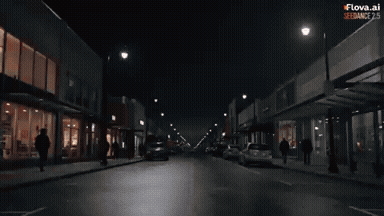

# external-video-model

<table>
<tr>
<td width="33%" valign="top">
 
<strong>Meteor Time-Freeze Cinematic Sequence Prompt Orchestrated by Opu…</strong> 
Use: Cinematic sci-fi scene generation via prompt orchestration Inputs: User inputs not specified by the author Tools: Flova.ai / Seedance 2.5 
<a href="https://x.com/MadMax_Series/status/2108577475752054868">Original post ↗</a> · <a href="../../prompts/2108577475752054868.md">Prompt ↗</a>
</td>
<td width="33%" valign="top">
 
<strong>Bragly Review Widgets Teaser Video</strong> 
Use: Product Feature Teaser Inputs: Product feature landing page for asset extraction; Product knowledge provided to the model Tools: Claude Opus 5.5 
<a href="https://x.com/UtsavChopra30/status/2108478302625071205">Original post ↗</a> · <a href="../../prompts/2108478302625071205.md">Prompt ↗</a>
</td>
<td width="33%" valign="top">
 
<strong>Pre-Computer Civilization Music Video via Multi-Tool Agent Orche…</strong> 
Use: AI Music Video Orchestration Inputs: User inputs not specified by the author Tools: Blender / ComfyUI / LTX-2.5 / Miniax H3 / YuE2 
<a href="https://x.com/mikumiku_aloha/status/2107848117584543896">Original post ↗</a> · <a href="../../prompts/2107848117584543896.md">Prompt ↗</a>
</td>
</tr>
<tr>
<td width="33%" valign="top">
 
<strong>Higgsfield Katana Preset Orchestration with Opus 5.5</strong> 
Use: AI Music Video Orchestration Inputs: Five uploaded character sheets used as reference. Tools: Higgsfield Katana / Seedance 2.5 
<a href="https://x.com/AI__TSUBAKI/status/2108484647713984755">Original post ↗</a> · <a href="../../prompts/2108484647713984755.md">Prompt ↗</a>
</td>
<td width="33%" valign="top">
 
<strong>Anime Cold Open: Westworld x Cowboy Bebop x Blade Runner 2049</strong> 
Use: Anime Cold Open Generation Inputs: User inputs not specified by the author Tools: NVIDIA RTX 4090 
<a href="https://x.com/gpbulkin/status/2108242769844310331">Original post ↗</a> · <a href="../../prompts/2108242769844310331.md">Prompt ↗</a>
</td>
<td width="33%" valign="top">
 
<strong>Night Monster</strong> 
Use: Cinematic horror creature reveal scene Inputs: User inputs not specified by the author Tools: Claude Opus 5.5 / Higgsfield / Seedance 2.5 
<a href="https://x.com/MadMax_Series/status/2108218235468325374">Original post ↗</a> · <a href="../../prompts/2108218235468325374.md">Prompt ↗</a>
</td>
</tr>
<tr>
<td width="33%" valign="top">
 
<strong>Airbnb UGC Tour Video via Opus 5.5 Orchestration</strong> 
Use: UGC Travel Promo Inputs: Airbnb listing URL for the decommissioned Titan II nuclear missile complex in Arkansas Tools: ElevenLabs / Seedance 2.5 / Topaz 
<a href="https://x.com/venturetwins/status/2107311661430493193">Original post ↗</a> · <a href="../../prompts/2107311661430493193.md">Prompt ↗</a>
</td>
<td width="33%" valign="top">
 
<strong>Garden of Earthly Delights Film Trailer</strong> 
Use: AI Film Trailer Production Inputs: Seedance API key provided to Claude Opus.; White Lotus theme song / audio track. Tools: Seedance API 
<a href="https://x.com/mickeyxfriedman/status/2107230816871055641">Original post ↗</a> · <a href="../../prompts/2107230816871055641.md">Prompt ↗</a>
</td>
<td width="33%" valign="top">
 
<strong>Bravilo SaaS Promotional Motion Graphics via Claude Code</strong> 
Use: Bravilo SaaS Promo Animation Inputs: User inputs not specified by the author Tools: Claude Code 
<a href="https://x.com/luchoalfonso_/status/2106780444163281084">Original post ↗</a> · <a href="../../prompts/2106780444163281084.md">Prompt ↗</a>
</td>
</tr>
<tr>
<td width="33%" valign="top">
 
<strong>iOS Jackpot Game App Prototype with Opus 5.5</strong> 
Use: Interactive Jackpot App Prototype Inputs: User inputs not specified by the author Tools: Claude Opus 5.5 / GPT 5 / higgsfield MCP / mobbin MCP 
<a href="https://x.com/rehanxahmed/status/2104939145252749710">Original post ↗</a> · <a href="../../prompts/2104939145252749710.md">Prompt ↗</a>
</td>
<td width="33%" valign="top">
 
<strong>Infinite Zoom Vintage Collage Animation</strong> 
Use: Infinite zoom collage animation Inputs: Requires external generation services Tools: GPT 2.5 / Kling 2.5 / Lyria 3 / Magnific MCP / Seedream 5 Pro 
<a href="https://x.com/koldo2k/status/2103129343253778767">Original post ↗</a> · <a href="../../prompts/2103129343253778767.md">Prompt ↗</a>
</td><td></td>
</tr>
</table>

[All tasks](../../README.md)
